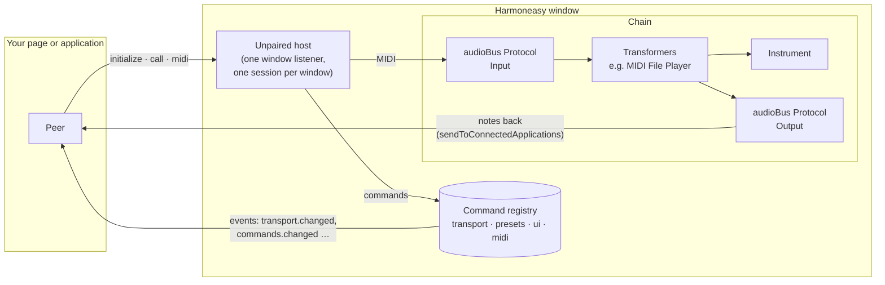
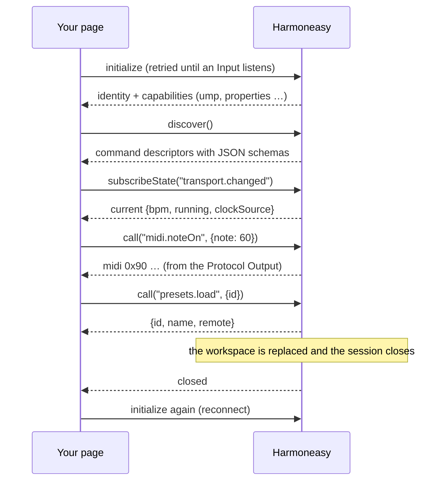
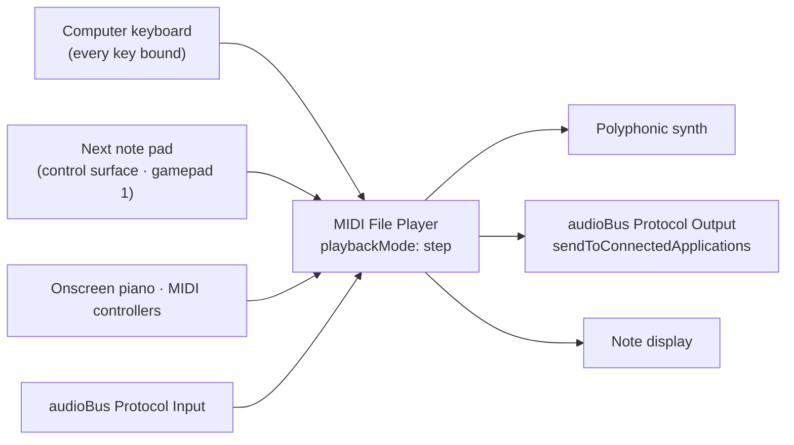
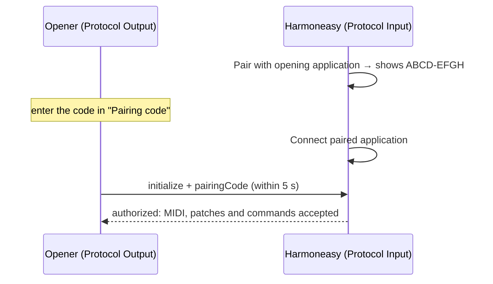

# audioBus Protocol

audioBus Protocol lets another web page or application **play** Harmoneasy (MIDI notes, controllers, pitch bend, aftertouch) and **control** it (transport, tempo, presets, and every control in the command palette). Harmoneasy can also **send** the notes a chain plays back to those pages.

The protocol is published as the standalone [`audiobus-protocol`](https://github.com/designerzen/audiobus-protocol) package. It runs over `postMessage`, and it still accepts legacy WebMidiLink `midi,…` strings.

- [Try it in two minutes](#try-it-in-two-minutes)
- [How it fits together](#how-it-fits-together)
- [Control Harmoneasy from your page](#control-harmoneasy-from-your-page)
- [Command reference](#command-reference)
- [Receive Harmoneasy's notes](#receive-harmoneasys-notes)
- [Presets for remote control](#presets-for-remote-control)
- [Add your own commands](#add-your-own-commands)
- [Pairing instead of open connections](#pairing-instead-of-open-connections)
- [Send to another application (Protocol Output)](#send-to-another-application-protocol-output)
- [MIDI 2 and properties](#midi-2-and-properties)
- [Development and tests](#development-and-tests)

## Try it in two minutes

```sh
pnpm --dir app/harmoneasy run dev
```

1. Open <http://localhost:1999/protocol-remote.html>. It embeds Harmoneasy with the **Step through a song** preset.
2. Press **Start** inside the embedded app. The status dot turns green when the page has connected.
3. Press **Next note** (or Space): the song moves forward one note, and the note shows up under **Sent by Harmoneasy**.
4. Try the drum pads, the transport, **Presets**, and **Every interface control**.

Inside the app, the **Remote** toolbar button opens the same page in a separate window. That page then controls the window that opened it (`protocol-remote.html?target=opener`).

| Page | What it demonstrates |
| --- | --- |
| [`protocol-remote.html`](http://localhost:1999/protocol-remote.html) | A complete remote control: notes, drums, controllers, transport, presets, every command, every property and every interface control |
| [`presets/protocol/step-song/`](http://localhost:1999/presets/protocol/step-song/) | Any key, pad, controller, gamepad or remote note plays the next song note, and that note is sent back to connected pages |
| [`presets/protocol/remote-playground/`](http://localhost:1999/presets/protocol/remote-playground/) | A lead with a Harmoniser and a Chordifier to switch and adjust, plus drums on channel 10 |
| [`presets/songs/never-gonna-jam-everything/`](http://localhost:1999/presets/songs/never-gonna-jam-everything/) | Play along with every input type, audioBus Protocol included |

## How it fits together



- An **audioBus Protocol Input** in a chain starts the listener; no pairing is needed. Every chain that has a protocol Input receives the remote MIDI, and application commands run only once, however many Inputs there are.
- Sessions are kept per sending window and replies go only to that window's exact origin. At most **8** windows can connect at once. An initialization that never completes expires after **10 s**. Opaque (`null`) origins are ignored.
- When the session closes, notes and sustain it was holding are released. A session closes when the remote closes, when the last protocol Input is removed, or when a preset is loaded.

A typical session:



## Control Harmoneasy from your page

Embed or open Harmoneasy with a preset that has an audioBus Protocol Input, then connect. Keep retrying the connection: Harmoneasy only listens once someone has pressed **Start** and the preset's Input exists.

```js
import { Peer, windowTransport } from "audiobus-protocol"

const frame = document.querySelector("iframe")
frame.src = "https://designerzen.github.io/harmoneasy/presets/protocol/step-song/"
const origin = new URL(frame.src).origin
let peer

async function connect() {
	peer?.close()
	for (;;) {
		const attempt = new Peer(windowTransport(frame.contentWindow, origin), {
			identity: { name: "My controller", version: "1" },
			timeoutMs: 4000,
			onMidi: (bytes) => console.log("Harmoneasy played", [...bytes]),
			onEvent: (topic, data) => console.log(topic, data),
			// Preset loads and reloads close the session: connect again.
			onClosed: () => attempt === peer && connect()
		})
		try {
			await attempt.connect()
			peer = attempt
			return
		} catch {
			attempt.close()
			await new Promise((resolve) => setTimeout(resolve, 1500))
		}
	}
}
frame.addEventListener("load", connect)
```

Once connected:

```js
// Play: "next note" in the step-through preset is any note on.
await peer.call("midi.noteOn", { note: 60, velocity: 100, channel: 1 })
await peer.call("midi.noteOff", { note: 60, channel: 1 })
peer.sendMidi([0x99, 36, 110]) // raw WebMidiLink MIDI also works: kick on channel 10

// Transport, and its state (captured together with the subscription)
const { state } = await peer.subscribeState("transport.changed")
await peer.call("transport.setTempo", { bpm: 128 })
await peer.call("transport.start")

// Presets: list, then load one. The session closes and onClosed reconnects.
const presets = await peer.call("presets.list", { query: "protocol" })
await peer.call("presets.load", { id: presets[0].id })

// Any interface control the command palette can reach
const controls = await peer.call("ui.list", { query: "chordifier" })
const toggle = controls.find((control) => control.kind === "toggle")
await peer.call("ui.activate", { id: toggle.id })
const choice = controls.find((control) => control.kind === "choice")
await peer.call("ui.setValue", { id: choice.id, value: choice.options[1] })
```

Pages served from another origin can embed Harmoneasy in an iframe or open it with `window.open`. Deployments that send `Cross-Origin-Opener-Policy: same-origin` (the Cloudflare Pages build) cut the link to a cross-origin opener, so embed those instead. Starting audio and file pickers still need a click inside Harmoneasy.

## Command reference

Every command is discoverable through `discover()`, with a JSON schema for its arguments and an `available` flag. The same handlers back the command palette, so palette and remote behave identically.

### Transport and application

| ID | Arguments | Result |
| --- | --- | --- |
| `transport.get` | — | `{bpm, running, clockSource}` |
| `transport.setTempo` | `{bpm}` (10–303) | transport state. Available only while the internal clock is controlled locally |
| `transport.start` / `transport.stop` | — | transport state. Unavailable while following a shared, MIDI or DVS clock |
| `app.panic` | — | `null`; releases notes in every chain |

`transport.changed` is retained, so `subscribeState` returns the current state along with the subscription. Changes from local controls, external clocks and rooms are picked up every 100 ms. `commands.changed` tells you to discover again, for example when availability changes.

### Presets

| ID | Arguments | Result |
| --- | --- | --- |
| `presets.list` | `{query?}`: words matched against name, category and description | `[{id, name, category, description, remote}]` |
| `presets.load` | `{id}` | the preset. Replies first, then replaces the workspace and applies the preset's tempo |

`remote: true` means the preset has an audioBus Protocol Input, so you can reconnect after loading it. If you load a preset with `remote: false`, the page loses control until Harmoneasy is reopened with a remote-capable preset. One way to reopen it is to navigate the frame to `presets/<route>/`.

### Interface controls

| ID | Arguments | Result |
| --- | --- | --- |
| `ui.list` | `{query?}` | `[{id, label, context, kind, value, options?, min?, max?, step?}]` |
| `ui.activate` | `{id}` | the control after it is pressed (`kind` `action` or `toggle`) |
| `ui.setValue` | `{id, value: string}` | the control after it is set (`kind` `choice`, `number` or `text`) |

A control is listed exactly when the palette would offer it: visible, enabled and not inside a closed dialog. This covers control surfaces, device panels and transformer settings. IDs combine context and label, such as `transport/play`, with `~2` added to repeated names. IDs stay stable while the interface is unchanged, so list again after opening a panel or loading a preset. Choices accept either an option's text or its value. Numbers are checked against the control's range.

### MIDI (`org.audiobus.midi` v1)

| ID | Arguments |
| --- | --- |
| `midi.noteOn` / `midi.noteOff` | `note`, `velocity?` (default 100), `channel?` (1–16, default 1) |
| `midi.polyAftertouch` | `note`, `pressure`, `channel?` |
| `midi.channelAftertouch` | `pressure`, `channel?` |
| `midi.pitchBend` | `value` (−8192…8191, 0 = centre), `channel?` |
| `midi.controlChange` | `controller`, `value`, `channel?` |
| `midi.programChange` | `program`, `channel?` |
| `midi.allNotesOff` | `channel?` |

These commands and raw `midi,…` messages from the same window take the same route into the Input's chain. SysEx is dropped unless the host sets `allowSysex: true`.

## Receive Harmoneasy's notes

Add an **audioBus Protocol** output to a chain and tick **Also send to applications connected to this window**. Every window connected through a protocol Input then receives that chain's transformed MIDI in its `onMidi` callback. No destination URL or pairing is needed. The setting works alongside a paired destination, and notes still held are released when the output is removed.

```json
{
	"id": "remote-echo",
	"direction": "output",
	"definition": {
		"factory": "output",
		"type": "protocol",
		"options": { "mode": "audiobus", "url": "", "sendToConnectedApplications": true }
	}
}
```

Your page receives what the chain actually played, not what you sent. In **Step through a song**, sending note 60 returns the song's next melody note. Do not send received notes back into Harmoneasy, or they will loop.

## Presets for remote control

A preset accepts remote control when one of its chains has a protocol Input with open connections:

```json
{ "id": "remote-application", "direction": "input",
  "definition": { "factory": "input", "type": "protocol", "options": { "acceptUnpaired": true } } }
```

The **Step through a song** preset (`presets/protocol/step-song.json`) wires these inputs into one chain:



The pad on the control surface is a `channel-trigger` input, linked to the surface with `{"key": "[\"next-note-pad\",\"trigger\"]", "widget": "pad"}`. The **Remote control playground** has two chains. The first sends every channel except 10 through a Harmoniser and a Chordifier to a lead synth. The second sends channel 10 to a drum kit, using `receiveChannels`. Their control surfaces give `ui.list` toggles, choices and sliders to work with.

## Add your own commands

Register your commands with the shared registry. They then appear in `discover()` for every remote, and in the command palette with a form generated from their schema.

```ts
import { getProtocolRegistry, TOPIC_COMMANDS_CHANGED } from "audiobus/io/protocol-registry"

const registry = getProtocolRegistry()
const unregister = registry.register({
	id: "mixer.setVolume",
	title: "Set master volume",
	description: "Master volume from 0 to 1",
	inputSchema: {
		type: "object",
		properties: { volume: { type: "number", minimum: 0, maximum: 1 } },
		required: ["volume"],
		additionalProperties: false
	},
	available: () => audioStarted,
	execute: ({ volume }) => {
		bus.volume = volume as number
		return { volume: bus.volume }
	}
})
registry.publish(TOPIC_COMMANDS_CHANGED, null) // when availability changes
```

Arguments are validated against `inputSchema` before `execute` runs. Throw `new ProtocolError("invalid_params", message)` to reject a call with a reason. See `app/harmoneasy/source/services/application-commands.ts` for transport, presets, properties and bundles, and `interface-commands.ts` for `ui.*`.

## Pairing instead of open connections

Open connections are the default (`acceptUnpaired: true`): any window that opens or embeds Harmoneasy can control it. To allow only one paired application, expand **Advanced connection settings** in the Input and turn off **Accept control from any window without pairing**. That setting is saved with the project.



Until the code is presented, the Input ignores MIDI and patches and rejects commands. Five wrong codes lock the pairing until a new code is generated. Codes and window references are never saved.

A host that embeds Harmoneasy can pair in code:

```ts
import InputProtocol from "audiobus/io/inputs/input-protocol"

const input = new InputProtocol({ acceptUnpaired: false })
input.attach(iframe.contentWindow!, new URL(iframe.src).origin)
await input.connect()
console.log(await input.connection!.list())
input.destroy()
```

## Send to another application (Protocol Output)

The **audioBus Protocol** output sends a chain's MIDI to another application. You can pair it from its panel (destination URL, **Open and pair destination**, pairing code, **Connect**) or in code:

```ts
import OutputProtocol from "audiobus/io/outputs/output-protocol"
import { EVENT_PROTOCOL_EVENT } from "audiobus/events/event-constants"

const output = new OutputProtocol({ applicationName: "Harmoneasy" })
output.attach(iframe.contentWindow!, new URL(iframe.src).origin)
await output.connect()
console.log(await output.discover()) // the destination's commands
output.addEventListener(EVENT_PROTOCOL_EVENT, (event) => console.log((event as CustomEvent).detail))
await output.call("transport.setTempo", { bpm: 128 })
output.noteOn(60, 100, 2)
output.noteOff(60, 2)
output.destroy() // releases held notes and sustain first
```

The **WebMidiLink (MIDI and patches)** mode is for synths that only accept legacy messages: it sends MIDI plus `requestPatch()`/`setPatch()`, but no commands. `attachTransport(transport)` accepts an already authorized custom transport, such as desktop IPC, that is isolated to one destination. To connect two Harmoneasy windows, use an Output in one window and a paired Input in the other. Keep routing one way to avoid feedback.

## MIDI 2 and properties

- Inputs and Outputs negotiate the `ump` capability and keep full UMP words, including 16-bit velocity, 32-bit controllers, per-note data and groups 0–15. When the destination cannot take UMP, the Output refuses it. **Allow lossy MIDI 1 conversion for group zero** opts into converting representable group-zero messages for that destination; other groups are never merged.
- Harmoneasy publishes scalar properties: `transport.tempo` (number, 10–303 BPM, writable while the internal clock is local), `transport.running` and `transport.clockSource` (read-only). Use `listProperties()`, `getProperty(id)` and `setProperty(id, value)`. Subscribe to `properties.changed` (`{id, value}`) and `properties.listChanged`.
- `org.audiobus.transport` v1 is a bundle of the five transport/panic commands and these three properties. `listBundles()` discovers it. Check each member's availability at runtime.

This is an audioBus application contract inspired by MIDI-CI Property Exchange. It does not implement MIDI-CI SysEx discovery, MUIDs, chunking or Profiles.

## Development and tests

To work on the protocol package itself, clone it next to this checkout. The workspace then uses the local copy instead of the pinned GitHub commit:

```sh
git clone https://github.com/designerzen/audiobus-protocol.git ../audiobus-protocol
(cd ../audiobus-protocol && npm install && npm test)
pnpm install --ignore-scripts
```

Rebuild it (`npm run build`) after editing. The package's `examples/receiver.html` is a standalone destination for testing the Protocol Output.

```sh
cd app/harmoneasy
pnpm exec vitest run tests/input-protocol.test.ts tests/input-protocol-commands.test.ts \
  tests/output-protocol.test.ts tests/application-commands.test.ts \
  tests/command-palette-protocol.test.ts tests/protocol-presets.test.ts
```

Then run the [demo pages](#try-it-in-two-minutes) to check the whole round trip in a browser.
